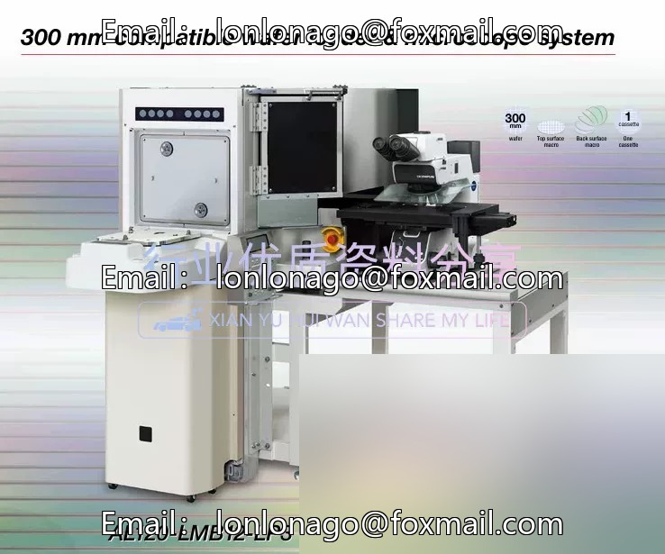
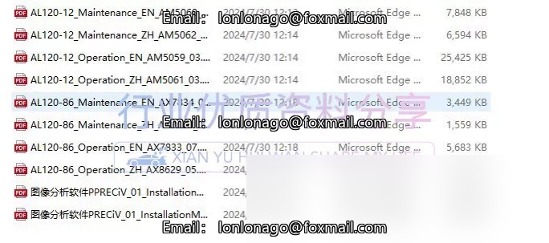
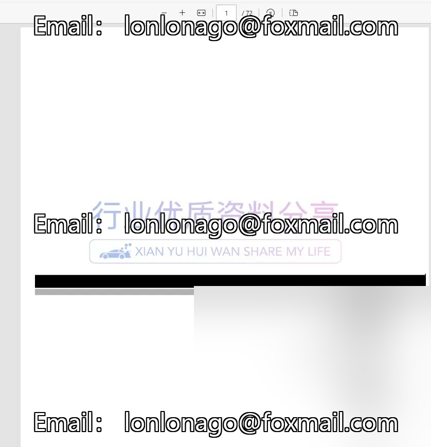
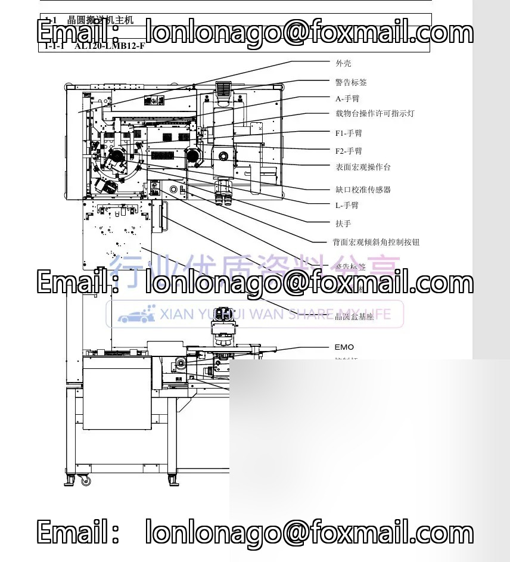
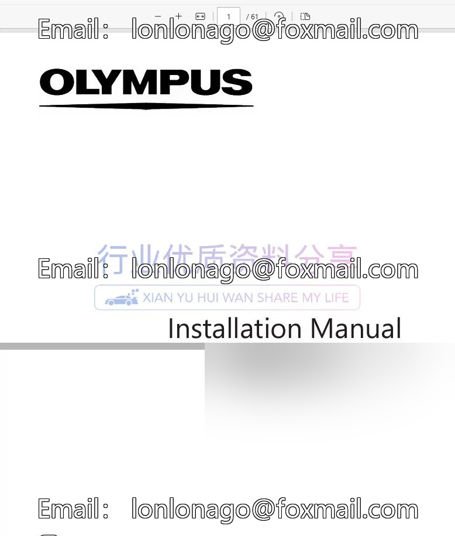
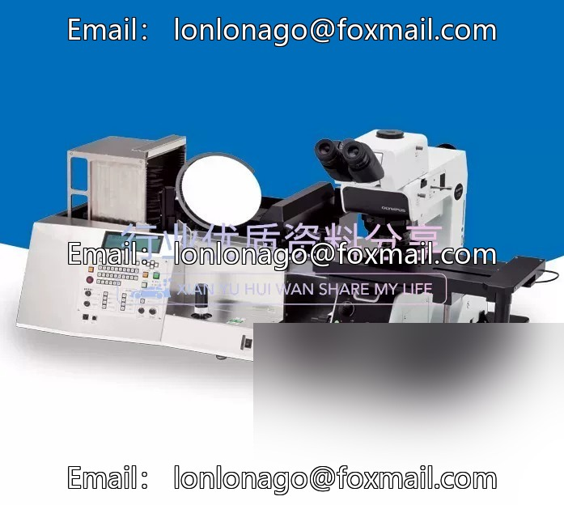
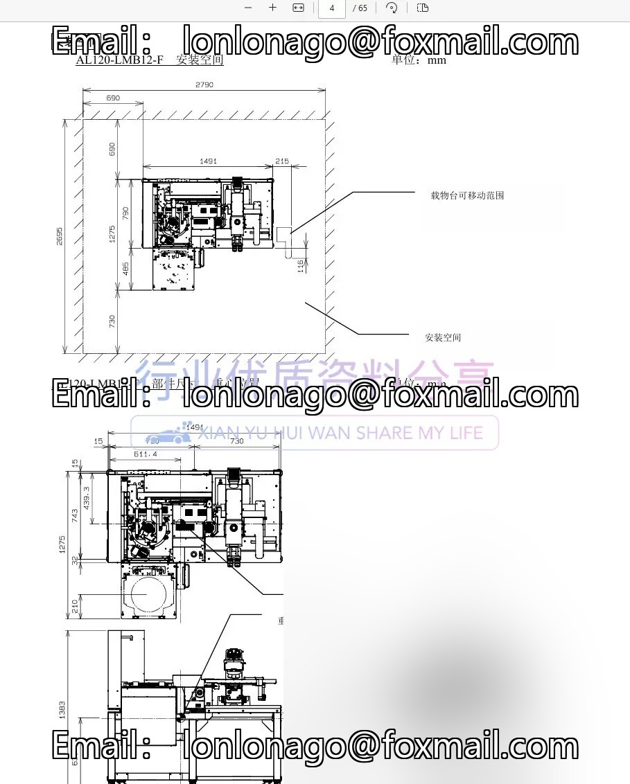

# EDN inspection transfer machine manual, maintenance manual, and other materials set (Chinese and English)

## Body

Working manuals, maintenance manuals, and other materials in full sets (Chinese and English) for wafer detection transfer machine.

Aolines Brand

Capture and send the electronic original directly! The following images include screenshots of the file portion. Please confirm before placing the order! Due to the replicable nature of electronic documentation Therefore, are allowed after purchase! Thanks for understanding!

For personal learning and reference use only.

The materials include operating and maintenance manuals for wafer detection conveyors, branded Olinas, in both Chinese and English, along with file sections and screenshots shown in the images.

<!-- AI_ENRICHED -->

## Images

## Payment

Here is a pay link on Stripe ( https://buy.stripe.com/3cs8yP7sY87d0vu9AB ). Please contact me lonlonago@foxmail.com after funding $89, and I will send you a complete data files , thank you!

